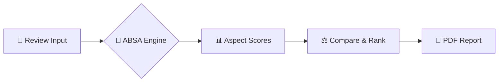

<div align="center">

  <!-- Main Banner Header -->

  <h1><span style="color: #1E3D34;">ROAM</span><span style="color: #D88394;">RATE</span></h1>

  <h3><i>"Don't just read reviews. Understand them."</i></h3>

  <p>

    An enterprise-grade, AI-powered travel & hotel review intelligence platform.<br/>

    Extracting sentiment, aspect breakdown, and actionable travel insights from unstructured user feedback.

  </p>

  <!-- GitHub Badges -->

  

  

  

  

</div>

---

## 🌟 Executive Overview

**Roam Rate** moves hotel reviews beyond basic 1-to-5 star metrics. By leveraging **Aspect-Based Sentiment Analysis (ABSA)**, the platform parses unformatted user reviews into granular sentiment scores across key categories like **Location**, **Staff**, **Cleanliness**, and **Wi-Fi**.

> 💡 **Core Differentiator:** Roam Rate doesn't just display review text—it automatically extracts pattern trends, aggregates comparative performance data, and generates executive travel summaries in real-time.

---

## 🎨 Visual Color Palette & Design System

The platform's UI and documentation follow a luxury editorial travel-tech visual identity:

| Palette Role | Hex Code | Visual Sample | Application |
| :--- | :--- | :--- | :--- |
| **Primary Forest** | `#1E3D34` | `██████████` | Navigation, Headers, Primary Hero Badges |
| **Dusty Rose Accent** | `#D88394` | `██████████` | Primary Buttons, Highlight Metrics, CTAs |
| **Sage Green** | `#648371` | `██████████` | Borders, Positive Sentiment Highlights |
| **Deep Plum** | `#5A2A38` | `██████████` | Section Subheadings, Warning & Flagged Badges |
| **Warm Sand** | `#F9F6F0` | `██████████` | App Backgrounds & Dynamic Cards |

---

## ⚡ Key Platform Capabilities

<table width="100%">

  <tr>

    <td width="50%">

      <h3 style="color: #1E3D34;">📊 Aspect-Based Sentiment</h3>

      <ul>

        <li>Deconstructs reviews into <b>7 key operational aspects</b>.</li>

        <li>Identifies isolated complaints (e.g., <i>Great staff, poor Wi-Fi</i>).</li>

        <li>Displays visual sentiment donut & progress charts.</li>

      </ul>

    </td>

    <td width="50%">

      <h3 style="color: #D88394;">🧪 Interactive AI Sandbox</h3>

      <ul>

        <li>Real-time single review testing engine.</li>

        <li>Provides instant confidence scores (e.g., <i>91% Confidence</i>).</li>

        <li>Extracts positive/negative topic tags automatically.</li>

      </ul>

    </td>

  </tr>

  <tr>

    <td width="50%">

      <h3 style="color: #648371;">⚖️ Side-by-Side Comparison</h3>

      <ul>

        <li>Compare 2–3 properties simultaneously.</li>

        <li>Aspect-by-aspect breakdown tables.</li>

        <li>Automated <b>AI Pick Recommendation</b> engine.</li>

      </ul>

    </td>

    <td width="50%">

      <h3 style="color: #5A2A38;">📈 Batch Ingest & Reporting</h3>

      <ul>

        <li>Admin CSV dataset drag-and-drop ingest.</li>

        <li>Instant dynamic graph & analytics updates.</li>

        <li><b>One-click PDF Project Report Generator</b>.</li>

      </ul>

    </td>

  </tr>

</table>

---

## 👥 Project Team & Core Roles

<table align="center">

  <tr>

    <td align="center" width="20%">

      <b style="color: #1E3D34;">Laverne</b><br/>

      <sub><b>Team Leader</b></sub><br/>

      Project oversight & sprint tracking

    </td>

    <td align="center" width="20%">

      <b style="color: #D88394;">Musa</b><br/>

      <sub><b>Researcher</b></sub><br/>

      Data collection & ABSA ML schema

    </td>

    <td align="center" width="20%">

      <b style="color: #648371;">Rebecca</b><br/>

      <sub><b>UI/UX & Demo</b></sub><br/>

      Design system & live presentation

    </td>

    <td align="center" width="20%">

      <b style="color: #5A2A38;">Ella</b><br/>

      <sub><b>Developer</b></sub><br/>

      Frontend/Backend & API integration

    </td>

  </tr>

</table>

---

## 🛠 Tech Stack Architecture

```text

               ┌─────────────────────────────────────────┐

               │        React + TypeScript + Tailwind    │

               └────────────────────┬────────────────────┘

                                    │

                  ┌─────────────────┴─────────────────┐

                  ▼                                   ▼

       ┌────────────────────┐               ┌────────────────────┐

       │   Supabase DB &    │               │  NLP / Sentiment   │

       │   Authentication   │               │ Analysis Pipeline  │

       └─────────┬──────────┘               └─────────┬──────────┘

                 │                                    │

                 ▼                                    ▼

       ┌────────────────────┐               ┌────────────────────┐

       │  Row-Level Security│               │  ABSA Engine +     │

       │  & CSV Batch Ingest│               │  Confidence Scoring│

       └────────────────────┘               └────────────────────┘

```

---

## 🚀 Getting Started

### Prerequisites

| Requirement | Version / Notes |
| :--- | :--- |
| Node.js | `v20+` |
| Package Manager | `bun` or `npm` |
| Supabase Account | For DB + Auth provisioning |

### Installation

```bash

# 1. Clone the repository

git clone https://github.com/laverne816/RoamRate.git

cd RoamRate

# 2. Install dependencies

bun install

# 3. Configure environment variables

cp .env.example .env

# 4. Run the development server

bun run dev

```

---

## 🧭 Application Journey



> ⚠️ **Note:** The AI sandbox accepts raw, unstructured text — no formatting required. The pipeline normalizes, tokenizes, and scores automatically.

---

## 📂 Repository Structure

```text

RoamRate/

├── src/               # React application source

│   ├── components/    # Reusable UI components

│   ├── pages/         # Route-level views (Dashboard, Sandbox, Compare)

│   └── lib/           # Sentiment engine & Supabase clients

├── public/            # Static assets

└── docs/              # Project reports & design specs

```

---

## 🗺 Roadmap

| Status | Feature |

| :--- | :--- |

| ✅ **Shipped** | Aspect-Based Sentiment Analysis (7 aspects) |

| ✅ **Shipped** | Interactive AI Sandbox with confidence scoring |

| ✅ **Shipped** | Side-by-side property comparison & AI Pick |

| ✅ **Shipped** | CSV batch ingest + PDF report generator |

| 🔄 **In Progress** | Multilingual review support (FR / DE / ZA) |

| 🔮 **Planned** | Public API for partner hotel integrations |

---

## 🤝 Contributing

Contributions are welcome! Please fork the repository, create a feature branch (`git checkout -b feature/amazing-feature`), and open a Pull Request.

1. 🍴 Fork the repo

2. 🔧 Create your feature branch

3. ✅ Commit your changes (`git commit -m 'Add amazing feature'`)

4. 📤 Push to the branch (`git push origin feature/amazing-feature`)

5. 🔀 Open a Pull Request

---

## 📄 License

Distributed under the **MIT License**. See [`LICENSE`](./LICENSE) for more information.

---

<div align="center">

  <sub><b style="color: #1E3D34;">ROAM RATE</b> — Built with 💚 by the Roam Rate Team</sub><br/>

  <sub><i>"Don't just read reviews. Understand them."</i></sub><br/><br/>

  

  

</div>
